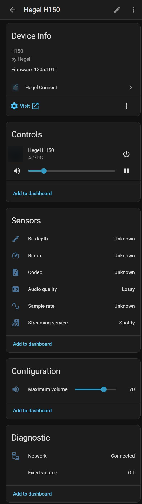

# Hegel Connect for Home Assistant

> **Unofficial community integration.** Not affiliated with, endorsed or supported by Hegel Music Systems AS. Hegel is a trademark of its owner.

Local-push integration for **Hegel H150, H200, H400 and H600** streaming amplifiers. It talks to the amplifier over your own network, the same way the amplifier's built-in web app does. No cloud, no account, and no polling: changes made on the amplifier, with its remote or in the Hegel Control app show up in Home Assistant right away (within a second on the maintainer's H150).



## Is it for my Hegel?

Hegel network amplifiers are controlled in two different ways:

| Generation | Models | How it is controlled | Use |
| :---- | :---- | :---- | :---- |
| **Streaming platform** | H150, H200, H400, H600 | Built-in streamer with a web API (the one the Hegel Control app uses) | **Hegel Connect** (this integration) |
| **IP control** | Röst, H95, H120, H190, H190V, H390, H590 | Hegel IP control protocol on TCP port 50001 | The built-in [Hegel integration](https://www.home-assistant.io/integrations/hegel/) in Home Assistant (since 2026.3) |

Quick check: on a streaming model `http://<amplifier-address>/webclient/` opens a Hegel page. If you try to add an older amplifier to Hegel Connect, setup recognises it (it answers a read-only IP control status query) and points you to the built-in integration.

| Model | Status |
| :---- | :---- |
| H150 | ✅ Tested by the maintainer |
| H200 | ✅ Works, reported by a user ([#17](https://github.com/Elpea-byte/ha-hegel-connect/issues/17)): status, artwork, track info and pause/play, also with Qobuz Connect |
| H400, H600 | 🟡 Expected to work, not tested yet. Hegel groups the H150, H400 and H600 together for home automation ([Hegel support](https://support.hegel.com/product-articles/custom-install-sue)) |

Own an H400 or H600? Please [send a model report](https://github.com/Elpea-byte/ha-hegel-connect/issues/new?template=model_report.yml), even if everything works. It takes five minutes and helps everyone. A report on more services of an H200 is welcome too: only status, artwork, track info and pause/play were confirmed there.

## Install

Needs Home Assistant 2025.4 or newer (developed and tested on 2026.11). Hegel Connect is in the default list of HACS, so you can search for it by name. Home Assistant 2026.11 replaced HACS with a built-in **Marketplace** (Settings > Marketplace); both use the same repositories.

[](https://my.home-assistant.io/redirect/hacs_repository/?owner=Elpea-byte&repository=ha-hegel-connect&category=integration)

The button opens this repository on your own Home Assistant (you enter its address once on the page it opens). Without the button:

- **Home Assistant 2026.11 and newer (Marketplace):** Settings > Marketplace, search for **Hegel Connect** and select *Install*. Restart Home Assistant if the Marketplace says so.
- **Home Assistant 2026.10 and older (HACS):** search for **Hegel Connect** in HACS, download it and restart Home Assistant.
- **If the search does not find it yet** (a new addition to the default list can take a while to show up; this also works as a fallback), add it as a custom repository. In the Marketplace: Settings > Marketplace > *Add from link*, enter `Elpea-byte/ha-hegel-connect`.
  - The first time, the Marketplace asks you to connect your GitHub account: you approve a code on GitHub, and it only reads public information. Updates of a repository added from a link are checked every 48 hours.
- **In HACS:** ⋮ > *Custom repositories* > add `https://github.com/Elpea-byte/ha-hegel-connect`, type *Integration*.
- **Manual:** copy `custom_components/hegel_connect` to the `custom_components` folder of your Home Assistant configuration and restart.

Updating to Home Assistant 2026.11 carries your HACS installs and custom repositories over to the Marketplace by itself.

## Set up

The amplifier is **discovered automatically**, the same way the Hegel Control app finds it (mDNS `_sues800device._tcp`, with UPnP/DLNA and Google Cast as backups). Open Settings > Devices & services, find it under *Discovered* and click *Add*.

Not discovered (other subnet or VLAN, multicast blocked)? Add it by hand: *Add integration* > **Hegel Connect** > enter the IP address of the amplifier (the button below starts the same setup). A fixed IP address (DHCP reservation in your router) is recommended; if the address does change, Home Assistant picks up the new one by itself the next time it sees the amplifier.

[](https://my.home-assistant.io/redirect/config_flow_start/?domain=hegel_connect)

To remove it: Settings > Devices & services > Hegel Connect > ⋮ > *Delete* (nothing on the amplifier changes), and uninstall it in HACS or the Marketplace too.

## First steps

You get one device with a **media player** (power, volume, mute, inputs, playback, now playing, media browser), **sensors** for the audio quality, codec, sample rate, bit depth, bitrate and streaming service, a **select** to start a radio favorite, a **maximum volume** number and two diagnostic binary sensors. Every entity, attribute and state is listed in the [reference](https://github.com/Elpea-byte/ha-hegel-connect/blob/main/docs/REFERENCE.md). Entity ids follow the language of Home Assistant when they are added (the now-playing event is `event.hegel_h150_now_playing` in English and `event.hegel_h150_nu_aan_het_spelen` in Dutch); yours are on the device page.

**Optional entities are off until you enable them.** To find them: Settings > Devices & services > Hegel Connect > your amplifier, open *+ n entities not shown* (or the *Entities* tab with the filter set to show disabled entities), pick the ones you want and enable them. Home Assistant reloads the integration after a short moment.

| Optional | What it does |
| :---- | :---- |
| [Start volume per input and remember volume](https://github.com/Elpea-byte/ha-hegel-connect/blob/main/docs/volume-per-input.md) | The volume that is set when Home Assistant switches input |
| [Auto standby](https://github.com/Elpea-byte/ha-hegel-connect/blob/main/docs/auto-standby.md) | The amplifier's own idle timer (5, 10 or 20 minutes). New in 0.7 |
| [Now-playing event](https://github.com/Elpea-byte/ha-hegel-connect/blob/main/docs/now-playing.md) | One event per new track, for listening logs and notifications. New in 0.7 |

**Inputs:** Settings > Devices & services > Hegel Connect > *Configure* lets you hide inputs you do not use and give inputs your own name, for example *RCA* → *TV*. This only changes how Home Assistant shows them; automations can still use the amplifier's own names. Renaming reloads the integration once, so the start volume entities get the new name.

**Maximum volume** is a number on the device page. Home Assistant never makes the volume louder than it; the amplifier's own remote and knob are not limited. Set it to protect your speakers and ears. [More about it](https://github.com/Elpea-byte/ha-hegel-connect/blob/main/docs/volume-per-input.md#maximum-volume).

**Automate:** [blueprints](https://github.com/Elpea-byte/ha-hegel-connect/blob/main/docs/blueprints.md) with one-click import (reconnect after a smart plug, radio at a set time, standby when idle, lower volume at night, log what plays; new in 0.8 and not released yet: follow the TV, switch on with the smart plug, a sleep timer and an announcement that puts the amplifier back), [examples](https://github.com/Elpea-byte/ha-hegel-connect/blob/main/docs/examples.md), and a recipe to [put the amplifier back after an announcement](https://github.com/Elpea-byte/ha-hegel-connect/blob/main/docs/announcements.md).

## Troubleshooting

Enable debug logging and reproduce the problem:

```yaml
logger:
  default: warning
  logs:
    custom_components.hegel_connect: debug
```

Then open an [issue](https://github.com/Elpea-byte/ha-hegel-connect/issues/new/choose) with the log and the diagnostics file (Settings > Devices & services > Hegel Connect > ⋮ > *Download diagnostics*; it contains no IP address or device ids).

| Symptom | Cause and fix |
| :---- | :---- |
| The amplifier is not discovered | Discovery uses multicast, which does not cross another subnet or VLAN and is blocked on some networks. Add it by hand with its IP address (see *Set up*). |
| *Cannot reach the amplifier on this address* | Wrong address, or the amplifier is not on the network (standby is fine, switched off at the mains is not). Open `http://<address>/webclient/` in a browser: if that page does not open, Home Assistant cannot reach it either. |
| *A device answered, but it does not look like a Hegel* | The address belongs to something else, or to a model that is not on the streaming platform. Other brands on the same platform (Onkyo) announce the same discovery service; the model the device reports decides. Expected from the code; not tried with such a device. |
| The built-in Hegel integration also shows the amplifier as *Discovered* | That one is for the IP-control models. Choose *Ignore* on it. |
| Entity ids differ from this README | Entity ids follow the language Home Assistant had when they were added (for example `..._nu_aan_het_spelen` in Dutch). Yours are on the device page. |
| Next, previous or stop are missing with Spotify | Spotify Connect only allows pause through the amplifier. Use the Spotify app. |
| A *Start volume* entity is *unavailable* | That input has fixed volume (home theater bypass), which Hegel Connect learned when Home Assistant switched to it. See the volume page. |
| *Configure* says the inputs are not known yet | Hegel Connect has not read the inputs yet: wait until the amplifier is connected and try again. Expected from the code; not tried. |
| Now playing and the stream sensors are empty | They only show something on the network input (the media player is *on* on other inputs). If it stays empty on the network input, a new firmware may have renamed it: please open an issue. |

**Amplifier switched off at the mains or unplugged?** When it comes back, Home Assistant normally notices within a minute (it retries after 5, 10, 20, 40 and then every 60 seconds). To reconnect at once, call `homeassistant.update_entity` on any Hegel Connect entity (for example `media_player.hegel_h150`), or use the blueprint *Smart plug: reconnect at once*. It only helps once the amplifier answers on the network again: right after power-on it needs about 20 to 45 seconds to start (on an H150).

## Features

- **Control:** power (on and network standby), volume and mute with a maximum Home Assistant never exceeds, inputs read from the amplifier (hide and rename them), reliable input switching (waits until the amplifier is on and checks the input stays selected).
- **Playback:** play, pause, next, previous, stop, seek, shuffle and repeat, only where the current [streaming service allows it](https://github.com/Elpea-byte/ha-hegel-connect/blob/main/docs/streaming-services.md).
- **Media browser:** your radio favorites, all internet radio, media servers (UPnP/DLNA, for example a NAS), a USB stick in the amplifier (not tested yet) and recently played, podcasts (open a podcast to pick an episode; new in 0.8, not released yet), and a search for internet radio and podcasts through the action `media_player.search_media` (radio new in 0.7, podcasts new in 0.8 and not released yet; Home Assistant's own media browser has no search box yet, but cards and Assist that use the action do). Nothing to set up.
- **Radio favorite select** and a **radio favorites sensor** with the station logos, for automations, voice and dashboard cards.
- **Now playing:** title, artist, album, cover art, service, length and position; sensors for audio quality (Hi-Res, CD, Lossless, Lossy, DSD), codec, sample rate, bit depth and bitrate.
- **Status you can trust:** instant updates (local push), a network sensor that tells standby from switched off at the mains (then the other entities are *unavailable*, new in 0.8 and not released yet), starts while the amplifier is off at the mains, a fixed-volume indicator.
- **Setup:** found automatically, older models recognised, diagnostics without IP address or device ids, English, Dutch, Norwegian (Bokmål), German, French and Spanish.

## Reference

- [All documentation pages](https://github.com/Elpea-byte/ha-hegel-connect/blob/main/docs/README.md) · [Reference: entities, states, attributes and errors](https://github.com/Elpea-byte/ha-hegel-connect/blob/main/docs/REFERENCE.md) · [What each streaming service allows](https://github.com/Elpea-byte/ha-hegel-connect/blob/main/docs/streaming-services.md) · [Roadmap](https://github.com/Elpea-byte/ha-hegel-connect/blob/main/docs/ROADMAP.md) · [Changelog](https://github.com/Elpea-byte/ha-hegel-connect/blob/main/CHANGELOG.md)
- **How it works:** the same local web API as the amplifier's own web page and the Hegel Control app (`/api/getData`, `/api/setData` and a long-polling event queue). Nothing leaves your network. The amplifier's local API has no password: Hegel Connect checks that a device really is your amplifier (its id) before using a new address, but a device that imitates the whole Hegel API cannot be told apart, so keep the amplifier on a trusted network.
- **Known limitations:** Spotify Connect only allows pause (no next/previous/stop; use the Spotify app). Radio favorites are managed in the Hegel Control app. No network command is known for the DAC and display buttons of the remote. The network input is recognised by its name "Network"; if a future firmware renames it, now playing stays empty (please open an issue). Home Assistant's built-in *Hegel Amplifier* integration may show a streaming model as *Discovered*: choose *Ignore*.
- **Related:** [hegel-home-assistant](https://github.com/zerostorypoints/hegel-home-assistant) (`hegel_streaming`, MIT) targets the same amplifiers through the same local API; discovery on the `manufacturer`/`uuid` records and reading the id from `systemmanager:systemMember` were inspired by it. Do not install both for the same amplifier: Home Assistant would offer it twice.
- **Development:** the client in `custom_components/hegel_connect/api.py` has no Home Assistant dependencies and may move to its own package later. Tests replay a real H150 recording (`tests/fixtures/h150_session.json`): `pip install -r requirements_test.txt` and `pytest`. See [CONTRIBUTING.md](https://github.com/Elpea-byte/ha-hegel-connect/blob/main/CONTRIBUTING.md); AI coding agents: [AGENTS.md](https://github.com/Elpea-byte/ha-hegel-connect/blob/main/AGENTS.md).

## Why this project

I bought a new Hegel H150 and found that my Logitech Harmony Elite could not control it. In mid-September 2026 I started with Home Assistant to bring all my devices together. I looked for an integration for the new streaming Hegels and could not find one in HACS, so I built Hegel Connect for my own H150. It works well enough that I decided to share it with the community.

## Support the project

Hegel Connect is free and stays free. If it makes your listening a bit easier you can buy me a coffee; it helps me keep testing, fixing and adding support for more models.

[](https://ko-fi.com/elpeabyte)

## Disclaimer

Hegel Connect is a hobby project, shared for free and **used at your own risk**. It is provided "as is", without any warranty, and the maintainer and contributors are **not liable for any damage** to your amplifier, speakers, hearing, other equipment or data, or for any other loss, however caused. See the [MIT license](https://github.com/Elpea-byte/ha-hegel-connect/blob/main/LICENSE) for the full terms.

Hegel Connect only uses the amplifier's own local API, the same one the Hegel Control app and the amplifier's web page use. It makes no firmware or configuration changes; it only switches power, input, volume, mute and playback, like the app does. Volume commands from Home Assistant (including your automations) can be loud: set **Maximum volume** on the device page to protect your speakers and ears.

This is not an official Hegel product, and Hegel Music Systems AS does not support it. For problems with the integration, open an issue here, not with Hegel support.

## License

MIT
