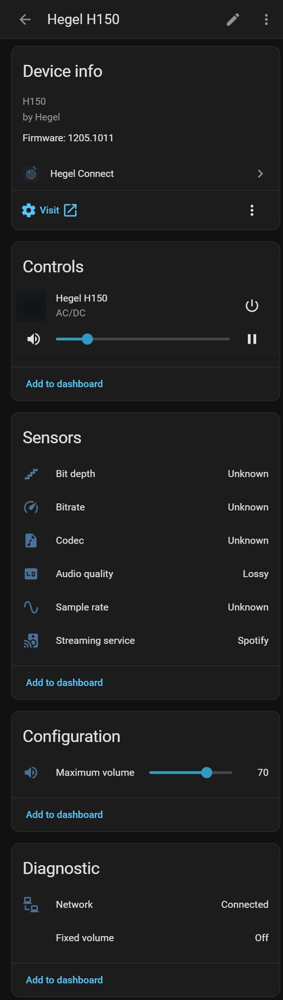

# Hegel Connect for Home Assistant

> **Unofficial community integration.** Not affiliated with, endorsed or supported by Hegel Music Systems AS. Hegel is a trademark of its owner.

Local-push integration for **Hegel H150, H200, H400 and H600** streaming amplifiers. It talks to the amplifier over your own network, the same way the amplifier's built-in web app does. No cloud, no account, and no polling: changes made on the amplifier, with its remote or in the Hegel Control app show up in Home Assistant right away (within a second on the maintainer's H150).

## At a glance

| | |
| :---- | :---- |
| **What** | Home Assistant custom integration (HACS or the Marketplace) for Hegel streaming amplifiers |
| **Models** | H150 and H200 (tested); H400, H600 (expected) |
| **Domain** | `hegel_connect` |
| **Platforms** | `media_player`, `sensor`, `binary_sensor`, `number`, `select`, `switch`, `event` |
| **Connection** | Local push over the amplifier's own web API (`iot_class: local_push`); no cloud, no account |
| **Discovery** | mDNS `_sues800device._tcp`, UPnP/DLNA (SSDP), Google Cast |
| **Not for** | Older IP-control models (Röst, H95, H120, H190, H390, H590): use the built-in Hegel integration |
| **Install** | Search for *Hegel Connect* in HACS (Home Assistant 2026.10 and older) or in the Marketplace (2026.11 and newer); a custom repository works too, or copy `custom_components/hegel_connect` |
| **License** | MIT |

## Why this project

I bought a new Hegel H150 and found that my Logitech Harmony Elite could not control it. In mid-September 2026 I started with Home Assistant to bring all my devices together. I looked for an integration for the new streaming Hegels and could not find one in HACS, so I built Hegel Connect for my own H150. It works well enough that I decided to share it with the community.

## Which integration for my Hegel?

Hegel network amplifiers are controlled in two different ways:

| Generation | Models | How it is controlled | Use |
| :---- | :---- | :---- | :---- |
| **Streaming platform** | H150, H200, H400, H600 | Built-in streamer with a web API (the same one the Hegel Control app and the amplifier's web page use) | **Hegel Connect** (this integration) |
| **IP control** | Röst, H95, H120, H190, H190V, H390, H590 | Hegel IP control protocol on TCP port 50001 | The built-in [Hegel integration](https://www.home-assistant.io/integrations/hegel/) in Home Assistant (since 2026.3) |

Quick check: on the H150, `http://<amplifier-address>/webclient/` opens a Hegel page; an amplifier that does this uses the streaming platform. If you try to add an older amplifier to Hegel Connect, setup recognises it (it answers a read-only IP control status query) and points you to the built-in integration.

## Supported models

| Model | Status |
| :---- | :---- |
| H150 | ✅ Tested by the maintainer |
| H200 | ✅ Works, reported by a user ([#17](../../issues/17)): status, artwork, track info and pause/play, also with Qobuz Connect |
| H400 | 🟡 Expected to work, not tested yet |
| H600 | 🟡 Expected to work, not tested yet |

Hegel groups the H150, H400 and H600 together for home automation ([Hegel support](https://support.hegel.com/product-articles/custom-install-sue)), so they are expected to behave the same. The H200 is a newer streaming model; a user confirmed it works ([#17](../../issues/17)). If you own an H200, H400 or H600, please [send a model report](../../issues/new?template=model_report.yml), even if everything works. It takes five minutes and helps everyone.

## Features



**Control**
- **Power**: on and network standby (the amplifier stays reachable in standby, so Home Assistant can switch it on)
- **Volume** (set and step) and **mute**, with a **maximum volume** that Home Assistant never exceeds
- **Inputs** read from the amplifier, so every model shows its own inputs; hide the ones you do not use and rename the others
- **Reliable input switching**: waits until the amplifier is on, pauses a running stream and checks the input stays selected (seen on the H150: right after power-on it otherwise jumps back to Network)
- **Playback**: play, pause, next, previous, stop, seeking within a track, shuffle and repeat, **only where the current service allows it** (see below)
- **Media browser**: your internet radio favorites, all internet radio, **media servers** (UPnP/DLNA, e.g. your NAS), a **USB stick** in the amplifier (not tested yet) and recently played. Nothing to set up: Hegel Connect shows the servers the amplifier finds itself. Albums are started the same way as in the Hegel web client, so the amplifier continues with the next track; photo and video folders are left out
- **Radio favorite select**: pick one of the stations saved in the Hegel Control app from a list, in an automation, a script, a voice command or any dashboard card (tested on an H150: switching stations while playing and starting a favorite from standby)
- **Radio favorites sensor** with the same stations including their logos, for custom dashboard cards

**Now playing and stream format**
- Title, artist, album, the playlist or album it plays from, cover art, streaming service, track length and position
- Sensors: **audio quality** (Hi-Res, CD quality, Lossless, Lossy, DSD), **codec**, **sample rate**, **bit depth**, **bitrate**, **streaming service**. The codec decides first, so 16-bit/48 kHz MP3 radio is *Lossy*, not *CD quality*

**Status you can trust**
- **Instant updates** (local push): changes made with the remote, on the front panel or in an app show up right away, no polling
- **Network sensor**: standby (still on the network) and switched off at the mains are told apart; the media player then shows *off*, not *unavailable*
- **Starts while the amplifier is off at the mains** (e.g. a power strip switched off at night) and connects as soon as it is back
- **Fixed volume** indicator for inputs set to home theater bypass

**Setup**
- **Found automatically**, the same way the Hegel Control app finds it; a changed IP address is picked up by itself
- Older Hegel amplifiers are recognised during setup and pointed to the right integration
- **Diagnostics** download without IP address or device ids
- English, Dutch, Norwegian (Bokmål), German, French and Spanish

<br clear="right">

### What each streaming service allows

The amplifier reports per service which controls work; Hegel Connect follows it, so buttons that would fail are not offered. Tested on the H150; "not tested yet" means what the code expects, not what was seen. Pause and play with Qobuz Connect were confirmed by a user on an H200.

| Source | Format shown | Next / previous | Stop | Seek | Shuffle / repeat |
| :---- | :---- | :---- | :---- | :---- | :---- |
| Spotify Connect | Service and quality only (Spotify sends no codec or bitrate) | No: the amplifier refuses it | Not offered (to keep the session with your phone) | No | No |
| Internet radio | Codec, bit depth, sample rate, bitrate | No | Offered | No | No |
| Media server (UPnP/DLNA, e.g. FLAC from a NAS) | Codec, bit depth, sample rate, bitrate | Yes (tested) | Offered (not tested yet) | Yes (tested) | Yes (tested, also follows changes made in the Hegel app) |
| TIDAL / Qobuz Connect | Not tested yet | Not tested yet | Offered (not tested yet) | Not tested yet | Not tested yet |
| AirPlay (e.g. Apple Music) | AirPlay's own label, like the Hegel web client (not tested yet) | Not tested yet | Offered (not tested yet) | Not tested yet | Not tested yet |
| Google Cast (e.g. YouTube Music) | Not tested yet | Not tested yet | Offered (not tested yet) | Not tested yet | Not tested yet |

With Spotify Connect, *play* after *pause* uses Spotify's own resume action; on the H150 a plain play command was refused there and stopped the session. Other services resume the way the Hegel web client does.

Live internet radio has no pause: *pause* stops the station, like the Hegel web client. After a stop there is nothing to resume, so start the station again from the media browser or a favorite. The media player's `can_pause` attribute is `false` while radio plays, so a card can show a stop button instead of pause.

### Entities

For an amplifier named *Hegel H150*:

| Entity | |
| :---- | :---- |
| `media_player.hegel_h150` | Power, volume, mute, input, playback, now playing, media browser. Extra attributes: `service`, `audio_format`, `can_pause`, `max_volume`, `fixed_volume` |
| `sensor.hegel_h150_audio_quality` | Hi-Res, CD quality, Lossless, Lossy, DSD (while the streamer plays) |
| `sensor.hegel_h150_streaming_service` | The service that plays (TIDAL, Spotify, radio, ...) |
| `sensor.hegel_h150_codec`, `_sample_rate`, `_bit_depth`, `_bitrate` | Stream details, when the service reports them (kept in history, no long-term statistics) |
| `event.hegel_h150_now_playing` | Fires `track_changed` when a new track starts, with title, artist, album, service, input, audio quality, codec, sample rate, bit depth, bitrate and whether it is radio. For listening logs, scrobbling and notifications |
| `select.hegel_h150_radio_favorite` | The radio favorites as options; choosing one starts that station, and it shows the favorite that is playing (unknown when something else plays) |
| `sensor.hegel_h150_radio_favorites` | Number of radio favorites; the list (title, icon, path) as attribute, for custom dashboard cards that show the station logos |
| `number.hegel_h150_maximum_volume` | Volume ceiling for Home Assistant (configuration) |
| `number.hegel_h150_start_volume_<input>` | Optional, off until you enable it: the volume to set when Home Assistant switches to that input (0 = leave the volume alone) |
| `switch.hegel_h150_remember_volume_per_input` | Optional, off until you enable it: switching to an input returns to the volume it had last |
| `binary_sensor.hegel_h150_network` | On while the amplifier answers, standby included (diagnostic) |
| `binary_sensor.hegel_h150_fixed_volume` | On when the current input uses fixed volume (diagnostic) |

Entity ids follow your Home Assistant language when they are added; the names above are the English ones, and your own ids are on the device page (Settings > Devices & services > Hegel Connect > your amplifier). Home Assistant 2026.11 shows entity names together with their device and area; existing entity ids stay as they are.

### Examples

Quieter in the evening:

```yaml
automation:
  - alias: Hegel volume limit at night
    triggers:
      - trigger: time
        at: "22:00:00"
    actions:
      - action: number.set_value
        target:
          entity_id: number.hegel_h150_maximum_volume
        data:
          value: 40
```

Start a radio favorite by name (the options follow the favorites in the Hegel Control app):

```yaml
action: select.select_option
target:
  entity_id: select.hegel_h150_radio_favorite
data:
  option: "Qmusic"
```

To start a station from a button or a dashboard card, use the select above. The attributes of the radio favorites sensor (title, icon and path of each station) are meant for custom cards that show the logos; such a card can start a station with the same `select.select_option` call.

Play an album from your NAS from a script or button. In the script editor, add the action *Media player: Play media*, choose the Hegel and click *Pick media*: you browse the same folders as in the media browser. The result looks like this (the id comes from your media server; if the server re-indexes your library it can change):

```yaml
action: media_player.play_media
target:
  entity_id: media_player.hegel_h150
data:
  media_content_type: hegel_path
  media_content_id: "upnp:/uuid:<server>/<album>?itemType=container"
```

### Now-playing event

`event.hegel_h150_now_playing` fires once for every new track, so an automation can log or announce what you play without watching the media player's attributes. It fires when the amplifier says "playing", so the quality details are there. It does not fire on pause or resume, nor when the same track plays on (repeat); a track that plays again after another one, or after you stopped, fires again. A track that is already playing when Home Assistant starts is not announced.

The event data has `title`, `artist`, `album`, `service`, `station`, `source`, `audio_quality`, `codec`, `sample_rate`, `bit_depth`, `bitrate` and `is_radio`; a value the amplifier does not report is empty. Write what you play to the logbook:

```yaml
automation:
  - alias: Hegel listening log
    triggers:
      - trigger: state
        entity_id: event.hegel_h150_now_playing
        not_from: [unavailable, unknown]
        not_to: [unavailable, unknown]
    actions:
      - action: logbook.log
        data:
          name: Hegel
          message: >-
            {{ trigger.to_state.attributes.artist }} - {{ trigger.to_state.attributes.title }}
            ({{ trigger.to_state.attributes.audio_quality }})
          entity_id: event.hegel_h150_now_playing
```

The two `not_` lines matter: the event entity goes *unavailable* when the integration reloads and comes back with the time of the last event, which a plain state trigger would log as a new track. (In the automation editor this is the option *Is not* on the state trigger, from Home Assistant 2026.11.) Only the very first event of a new entity is skipped, because it comes from *unknown*. The entity id depends on your Home Assistant language, for example `event.hegel_h150_nu_aan_het_spelen` in Dutch: find yours on the device page (Settings > Devices & services > Hegel Connect > your amplifier).

The blueprint [Log or announce what is playing](#blueprints) does all this for you, including a notification of your own and a filter on audio quality. Scrobbling itself is left to other integrations.

Good to know, from trying it on an H150:

- **Spotify**: `codec`, `sample_rate`, `bit_depth` and `bitrate` stay empty, because the amplifier does not receive them from Spotify. `audio_quality` is `lossy` (or `lossless` when the amplifier reports Spotify Lossless).
- **Internet radio**: the station is in `station`. The amplifier shows the station name first and the song a moment later, so the event comes with the song; stations send `Artist - Title` as one text, which is split into `artist` and `title` at the first ` - `. A station that never sends a song title gives no events, and a station that updates the title only now and then gives an event per update.
- **Same track again**: a track that plays on (repeat, or back to the start without a break) gives no new event. After a break (another input, the stream moved to a phone and back, or an announcement that interrupted it) the same track starts a new event.
- Tried on an H150 with Spotify, internet radio, pause and resume, next and previous track, switching input, and restarting Home Assistant while music played. Not tried: tracks from a media server (NAS) and other streaming services.

### Announcements: put the amplifier back afterwards

A spoken message or a doorbell sound on the amplifier interrupts what plays. A scene brings the amplifier back to where it was: Home Assistant stores the power state, input, volume and mute of a media player in a scene and restores them, so Hegel Connect needs nothing extra.

```yaml
sequence:
  - action: scene.create
    data:
      scene_id: hegel_before_announcement
      snapshot_entities:
        - media_player.hegel_h150
  - action: tts.speak
    target:
      entity_id: tts.your_text_to_speech   # your own text-to-speech entity
    data:
      media_player_entity_id: media_player.hegel_h150_cast   # the Cast entity of the amplifier
      message: "Dinner is ready"
  - delay: "00:00:08"   # long enough for the message; or wait until the Cast entity is idle
  - action: scene.turn_on
    target:
      entity_id: scene.hegel_before_announcement
```

What was tried on an H150 (the scene steps; the spoken message itself was not played):

- Input and volume come back, also from standby (the amplifier switches on first). Allow 4 to 8 seconds, from standby the longest.
- Internet radio starts again (live radio cannot continue); Spotify continues at the same place.
- A lower *Maximum volume* wins over the volume in the scene, and mute is restored as it was.
- The now-playing event fires again for the track that continues, because the stream was interrupted.

The amplifier cannot play a link of your own through its local interface (none was found), so the announcement itself goes through the Cast entity of the amplifier. In Home Assistant that entity may be disabled: enable it under the device first.

### Blueprints

Ready-made automations with a one-click import (Settings > Automations & scenes > Blueprints). They only list this integration's own entities.

- **Smart plug: reconnect at once**: Asks Hegel Connect to reconnect every few seconds after the plug that powers the amplifier turns on, until the amplifier answers (no waiting for the next retry).
  [](https://my.home-assistant.io/redirect/blueprint_import/?blueprint_url=https%3A%2F%2Fraw.githubusercontent.com%2FElpea-byte%2Fha-hegel-connect%2Fmain%2Fblueprints%2Fautomation%2Fhegel_connect%2Fsmart_plug_reconnect.yaml)
- **Radio at a set time**: Switches the amplifier on at a set time on the days you choose and starts one of your radio favorites, at a volume you pick (never above the maximum volume).
  [](https://my.home-assistant.io/redirect/blueprint_import/?blueprint_url=https%3A%2F%2Fraw.githubusercontent.com%2FElpea-byte%2Fha-hegel-connect%2Fmain%2Fblueprints%2Fautomation%2Fhegel_connect%2Fradio_at_time.yaml)
- **Standby when idle or nobody is home**: Puts the amplifier in standby after it has been idle on the network input for a while, and optionally when everyone has left home; other inputs are never switched off.
  [](https://my.home-assistant.io/redirect/blueprint_import/?blueprint_url=https%3A%2F%2Fraw.githubusercontent.com%2FElpea-byte%2Fha-hegel-connect%2Fmain%2Fblueprints%2Fautomation%2Fhegel_connect%2Fstandby_when_idle.yaml)
- **Lower the maximum volume at night**: Sets the maximum volume lower at night and back in the morning; a volume above the new maximum comes down at once.
  [](https://my.home-assistant.io/redirect/blueprint_import/?blueprint_url=https%3A%2F%2Fraw.githubusercontent.com%2FElpea-byte%2Fha-hegel-connect%2Fmain%2Fblueprints%2Fautomation%2Fhegel_connect%2Fnight_volume_limit.yaml)

- **Log or announce what is playing**: Writes every new track of the now-playing event to the logbook and, if you choose an action, runs it too (for example a notification); nothing is sent unless you choose one. Optional filters on audio quality and on internet radio.
  [](https://my.home-assistant.io/redirect/blueprint_import/?blueprint_url=https%3A%2F%2Fraw.githubusercontent.com%2FElpea-byte%2Fha-hegel-connect%2Fmain%2Fblueprints%2Fautomation%2Fhegel_connect%2Fnow_playing.yaml)

The blueprints use the amplifier's own name for the network input (*Network*). Hegel Connect accepts that name even when you gave the input your own name in the options.

## Installation

Developed and tested on Home Assistant 2026.11; HACS and the Marketplace allow installing it on 2025.4 and newer (the test suite also passes on 2025.4.4). The integration's own icon is shown from Home Assistant 2026.3 ([brand images](https://developers.home-assistant.io/blog/2026/02/24/brands-proxy-api)); older versions show no icon.

### HACS or the Marketplace (recommended)

Hegel Connect is in the default list of HACS, so you can search for it by name. Home Assistant 2026.11 replaced HACS with a built-in **Marketplace** (Settings > Marketplace). Both use the same repositories, so the steps differ only in where you click.

[](https://my.home-assistant.io/redirect/hacs_repository/?owner=Elpea-byte&repository=ha-hegel-connect&category=integration)

The button opens this repository on your own Home Assistant (you enter its address once on the page it opens): in HACS before 2026.11, in the Marketplace from 2026.11. Without the button:

**Home Assistant 2026.11 and newer (Marketplace)**

1. Settings > Marketplace, search for **Hegel Connect** and select *Install*.
2. Add it under Settings > Devices & services (restart Home Assistant first if the Marketplace says so).

**Home Assistant 2026.10 and older (HACS)**

1. In HACS, search for **Hegel Connect** and download it.
2. Restart Home Assistant.

**If the search does not find it yet**, add the repository yourself. A new addition to the default list can take a while to show up, and this also works as a fallback later:

- Marketplace: Settings > Marketplace > *Add from link*, enter `Elpea-byte/ha-hegel-connect`. The first time, the Marketplace asks you to connect your GitHub account: you approve a code on GitHub, and it only reads public information. Updates of a repository added from a link are checked every 48 hours.
- HACS: ⋮ > *Custom repositories* > add `https://github.com/Elpea-byte/ha-hegel-connect`, type *Integration*.

Updating to Home Assistant 2026.11 carries your HACS installs and custom repositories over to the Marketplace by itself.

### Manual

Copy `custom_components/hegel_connect` to the `custom_components` folder of your Home Assistant configuration and restart.

## Configuration

The amplifier is **discovered automatically**, the same way the Hegel Control app finds it (mDNS service `_sues800device._tcp`), with UPnP/DLNA and Google Cast as backups. Home Assistant then shows it under Settings > Devices & services > *Discovered*; click *Add*.

Not discovered (other subnet/VLAN, multicast blocked)? Add it by hand: *Add integration* > **Hegel Connect** > enter the IP address.

Most people do not need this button, because the amplifier shows up under *Discovered* by itself. It only asks *Do you want to set up Hegel Connect?* on your Home Assistant; press *OK* to start the same setup where you enter the address yourself:

[](https://my.home-assistant.io/redirect/config_flow_start/?domain=hegel_connect)

A fixed IP address (DHCP reservation in your router) is still recommended. If the address does change, Home Assistant picks up the new one by itself the next time it sees the amplifier on the network.

**Inputs**: Settings > Devices & services > Hegel Connect > *Configure* lets you hide inputs you do not use (they disappear from the source list and dashboards) and give inputs your own name, e.g. *RCA* → *TV*. This only changes how Home Assistant shows them; automations can still use the amplifier's own names. If you save the options through the API or a script instead of the form, send `hidden_sources` again with the new names; leaving it out shows the hidden inputs again. The form in the interface fills it in for you.

**Maximum volume** is a setting on the device page (a number entity, so automations can change it). Home Assistant will never make the volume louder than it; the amplifier's own remote and knob are not limited. Lowering the maximum below the current volume brings the volume down to the new maximum at once (not on an input with fixed volume, and not while the amplifier is off). If you turned the amplifier above the limit yourself, *louder* from Home Assistant does nothing and *quieter* goes straight down to the limit, not one step. Volume steps are one point on the amplifier's scale.

**Volume per input** is optional and does nothing until you enable it. The amplifier only has one *power-on volume* for all inputs; this goes further and is done by Home Assistant:

Both are switched off by default, so you will not see them on the device page at first. To find them: Settings > Devices & services > Hegel Connect > your amplifier, then open *+ n entities not shown* (or the *Entities* tab with the filter set to show disabled entities), choose the ones you want and enable them. Home Assistant reloads the integration after a short moment.

- `number.hegel_h150_start_volume_<input>`, one per input: the volume to set when Home Assistant switches to that input. **0 means off**: the volume is left alone. The slider goes up to your maximum volume.
- `switch.hegel_h150_remember_volume_per_input`: the volume you used last on each input is brought back when you switch to it. A volume is only remembered after you change it on that input; an input where you never touched the volume keeps whatever the amplifier has. Turning the switch off throws the remembered volumes away. A start volume set for an input wins over the remembered one.
- **Only when Home Assistant switches the input** (the source list, scripts, automations, the dashboard). Switching with the amplifier's own remote or the Hegel app, or by an app such as Spotify taking the amplifier over, is left alone. The same goes for switching the amplifier on: it keeps the input it had, and the volume is only set when the input is switched afterwards. For a safe volume at power-on, use the amplifier's own *power-on volume* setting in the Hegel Control app.
- The maximum volume always applies. An input with **fixed volume** cannot have a start volume: once you have switched to such an input from Home Assistant, its start volume entity turns *unavailable*.
- If you rename an input in the options, the start volume entity shows the new name after the integration is reloaded.
- **Fixed volume is only learned when you switch to the input.** The amplifier reports whether the volume is fixed for the input that is selected, not for the other inputs, so Hegel Connect cannot read it for all inputs at startup. The start volume entity of such an input looks normal until Home Assistant has switched to it once; from then on it is *unavailable* and a call to it is refused. The binary sensor *Fixed volume* shows it for the current input.

### Removing

Settings > Devices & services > Hegel Connect > ⋮ > *Delete*. This removes the amplifier and its entities from Home Assistant; nothing on the amplifier changes. Installed through HACS or the Marketplace? Uninstall it there as well and restart Home Assistant. The Marketplace first asks you to remove the setup (or offers *Delete and uninstall*).

## Troubleshooting

Enable debug logging and reproduce the problem:

```yaml
logger:
  default: warning
  logs:
    custom_components.hegel_connect: debug
```

**Amplifier switched off at the mains or unplugged?** When it comes back, Home Assistant normally notices within a minute (it retries after 5, 10, 20, 40 and then every 60 seconds). To reconnect at once, call the standard action `homeassistant.update_entity` on any Hegel Connect entity, for example from the automation that switches the power strip on:

```yaml
action: homeassistant.update_entity
target:
  entity_id: media_player.hegel_h150
```

It only helps once the amplifier answers on the network again; right after power-on it needs a little time to start (about 20 to 45 seconds on an H150). A call that comes too early fails quietly and the normal retries carry on.

If the amplifier hangs on a smart plug, wait for it to start and then ask for the connection. The delay is a starting point; adjust it to your amplifier (expected to work, the single call was tried on an H150 at the moment the amplifier answered):

```yaml
triggers:
  - trigger: state
    entity_id: switch.audio_plug   # your own plug
    to: "on"
actions:
  - delay: "00:00:45"
  - action: homeassistant.update_entity
    target:
      entity_id: media_player.hegel_h150
```

Then open an [issue](../../issues/new/choose) with the log and the diagnostics file (Settings > Devices & services > Hegel Connect > ⋮ > *Download diagnostics*).

## Known limitations

- Spotify Connect: next/previous and stop are not available through the amplifier (it only allows pause); use the Spotify app or Home Assistant's Spotify integration for skipping.
- Radio favorites are managed in the Hegel Control app; Home Assistant shows and plays them.
- No network command is known for the DAC and display buttons of the Hegel remote, so Hegel Connect does not offer them.
- Home Assistant's built-in *Hegel Amplifier* integration also listens for Hegel UPnP announcements. On the maintainer's H150 (Home Assistant 2026.9) it did not offer itself, but if it shows up as *Discovered* for a streaming model, choose *Ignore*: that integration is meant for the IP-control models (see the table at the top).
- Tested by the maintainer on the H150 and confirmed by a user on the H200; H400 and H600 reports are very welcome.
- The network input is recognised by its name "Network", as the amplifier reports it. If a future firmware renames it, now playing and the stream sensors stay empty; please open an issue.
- The amplifier's local API has no password. Hegel Connect checks that a device really is your amplifier (its id) before using a new address, but a device on your network that imitates the whole Hegel API cannot be told apart. Keep the amplifier on a trusted network.

## How it works

Hegel Connect uses the same local web API as the amplifier's own web page and the Hegel Control app: `/api/getData`, `/api/setData` and a long-polling event queue under `/api/event`. Nothing leaves your network.

## Related projects

[hegel-home-assistant](https://github.com/zerostorypoints/hegel-home-assistant) (`hegel_streaming`, MIT) targets the same amplifiers through the same local API. Matching discovery on the `manufacturer`/`uuid` TXT records and reading the id from `systemmanager:systemMember` were inspired by it.

Do not install both for the same amplifier: both announce themselves for the same discovery service, so Home Assistant would offer the amplifier twice. Pick one.

## Development

The client in `custom_components/hegel_connect/api.py` has no Home Assistant dependencies and may move to its own package later. Tests replay a real H150 recording (`tests/fixtures/h150_session.json`):

```bash
pip install -r requirements_test.txt
pytest
```

## Contributing

Bug reports, model reports and pull requests are welcome; see [CONTRIBUTING.md](CONTRIBUTING.md). AI coding agents: see [AGENTS.md](AGENTS.md). Changes per version are in [CHANGELOG.md](CHANGELOG.md).

## Support the project

Hegel Connect is free and stays free. If it makes your listening a bit easier and you want to say thanks, you can buy me a coffee. It helps me keep testing, fixing and adding support for more models.

[](https://ko-fi.com/elpeabyte)

## Disclaimer

Hegel Connect is a hobby project, shared for free and **used at your own risk**. It is provided "as is", without any warranty, and the maintainer and contributors are **not liable for any damage** to your amplifier, speakers, hearing, other equipment or data, or for any other loss, however caused. See the [MIT license](LICENSE) for the full terms.

Hegel Connect only uses the amplifier's own local API, the same one the Hegel Control app and the amplifier's web page use. It makes no firmware or configuration changes; it only switches power, input, volume, mute and playback, like the app does. Volume commands from Home Assistant (including your automations) can be loud: set **Maximum volume** on the device page to protect your speakers and ears.

This is not an official Hegel product, and Hegel Music Systems AS does not support it. For problems with the integration, open an issue here, not with Hegel support.

## License

MIT
